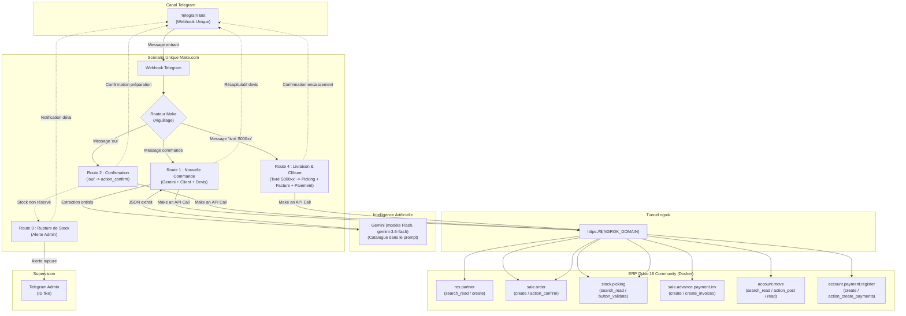

# COD-Flow : Automatisation ERP Odoo 18 pour le Cash On Delivery (Maroc)

[](https://www.odoo.com/)
[](https://www.docker.com/)
[](https://www.make.com/)
[](https://www.python.org/)
[](LICENSE)

---

## 📌 Présentation du Projet
Au Maroc, le commerce en ligne repose très largement sur le mode de paiement **Cash On Delivery (COD)**, où les commandes s'initient sur les applications de messagerie (notamment Telegram et WhatsApp) via des messages textuels en **Français** ou en **Darija marocaine translittérée (Arabizi)**.

La gestion manuelle de ce flux impose des contraintes opérationnelles :
- **Temps de saisie manuel significatif :** Traitement de chaque message informel pour créer le contact client dans l'ERP, sélectionner les articles et générer le devis (durée à mesurer).
- **Risques d'erreurs :** Coordonnées téléphoniques erronées ou adresses incomplètes pouvant bloquer la livraison.
- **Gestion des doublons et ruptures :** Risque de doublons lors de commandes répétées et nécessité de détecter immédiatement les ruptures de stock à la confirmation.
- **Clôture comptable à la livraison :** Nécessité d'enregistrer la facture et le paiement en espèces dès remise du colis par le transporteur.

**COD-Flow** est un **projet personnel de portfolio en automatisation ERP** reliant un bot Telegram, l'API Google Gemini, un scénario Make.com unique à 4 routes, et **Odoo 18 Community** exposé via un tunnel ngrok :
```text
Message Telegram (Client / Livreur)
  ──► Webhook Unique Make.com
  ──► Routeur Make (4 routes)
        ├── Route 1 : Nouvelle commande (Gemini (modèle Flash, gemini-3.6-flash) ──► Odoo res.partner + sale.order)
        ├── Route 2 : Confirmation "oui" (Odoo sale.order action_confirm + contrôle stock)
        ├── Route 3 : Rupture de stock (Alerte Telegram Admin)
        └── Route 4 : Livraison "livré S000xx" (Odoo picking + facture + paiement COD)
```

---

## 🏛️ Architecture Globale

Consultez la [documentation d'architecture détaillée](docs/architecture.md) pour les spécifications complètes.



> **Pourquoi un seul scénario Make ?** L'API Telegram Bot n'autorise qu'**un seul webhook actif par bot**. Toutes les interactions transitent donc par un webhook unique et sont aiguillées par un routeur Make. Tous les appels vers Odoo utilisent le module natif **"Make an API Call"** via le tunnel ngrok.

---

## 📁 Arborescence du Dépôt

```text
COD-Flow/
├── LICENSE                      # Licence MIT (HARISS Houssam)
├── README.md                    # Documentation principale du projet
├── odoo/
│   ├── docker-compose.yml       # Odoo 18 + PostgreSQL 16 + service ngrok (port configurable)
│   ├── .env.example             # Modèle de variables d'environnement (valeurs factices)
│   ├── .gitignore               # Protection des données locales et secrets
│   ├── odoo_client.py           # Client XML-RPC avec gestion d'erreurs et normalisation de domaines
│   ├── test_odoo_api.py         # Test de connexion et vérification des modules
│   ├── create_custom_fields.py  # Création idempotente des champs x_* sur sale.order
│   ├── seed_products.py         # Produits démo et stock initial via stock.quant
│   ├── seed_customers.py        # 5 clients démo avec numéros normalisés (+212)
│   ├── seed_orderpoints.py      # Règles de stock minimum par produit
│   └── check_setup.py           # Contrôle de conformité global (vérification stricte des stocks)
├── make-scenarios/
│   ├── README.md                # Vue d'ensemble du scénario unique et contrainte webhook
│   ├── route_1_nouvelle_commande.md  # Route 1 : Commande, Gemini, res.partner, sale.order
│   ├── route_2_confirmation.md       # Route 2 : Confirmation "oui", action_confirm, stock
│   ├── route_3_rupture_stock.md      # Route 3 : Alerte rupture admin Telegram
│   └── route_4_livraison.md          # Route 4 : Livré S000xx, picking, facture, paiement
├── llm/
│   ├── prompt_extraction.md     # Prompt système d'extraction (Français / Darija)
│   ├── schema.json              # Schéma JSON strict (Structured Outputs)
│   └── messages_test.json       # 22 messages de test variés
├── tests/
│   └── send_test_messages.py    # Simulateur d'envoi vers le Webhook Make
└── docs/
    ├── architecture.md          # Architecture technique et schéma Mermaid
    ├── cahier_des_charges.md    # Cahier des charges fonctionnel et technique
    ├── mesure.md                # Protocole expérimental et section Limites
    ├── mesure.csv               # Grille tabulaire (mesures réelles à compléter)
    └── post_linkedin.md         # Brouillon de présentation de projet
```

---

## 🛠️ Prérequis Système
- **Docker Desktop** ou moteur Docker avec Docker Compose.
- **Python 3.10+** (bibliothèque standard uniquement, sans dépendances tierces).
- Compte gratuit **Make.com** (scénario unique avec routeur).
- Compte **Telegram** (création d'un bot via `@BotFather` et identifiant administrateur).
- Compte **Google AI Studio** (clé API gratuite pour Gemini (modèle Flash, gemini-3.6-flash)).
- Compte gratuit **ngrok** avec domaine fixe configuré.

---

## 🚀 Guide d'Installation Pas à Pas

### 1. Préparer l'environnement
```bash
git clone https://github.com/votre-nom/COD-Flow.git
cd COD-Flow

# Créer votre fichier d'environnement à partir du modèle
cp odoo/.env.example odoo/.env
# Sous Windows PowerShell : Copy-Item odoo/.env.example odoo/.env
```

Éditez le fichier `odoo/.env` avec vos identifiants réels (mots de passe, tokens Telegram, clé Gemini, tokens ngrok).

---

### 2. Démarrer Odoo 18 et ngrok avec Docker
Le port Odoo exposé sur la machine hôte est configurable via la variable `ODOO_PORT` (par défaut `8269`).
```bash
cd odoo
docker compose up -d
```
Les trois conteneurs démarrent :
1. `codflow_postgres16` : Base de données PostgreSQL 16.
2. `codflow_odoo18` : Serveur Odoo 18 Community accessible sur `http://localhost:8269`.
3. `codflow_ngrok` : Tunnel HTTPS exposant le port Odoo sur votre domaine fixe (`https://${NGROK_DOMAIN}`).

Accédez à `http://localhost:8269` (ou votre port configuré) :
1. Créez une nouvelle base de données (ex: `codflow_db`) avec l'utilisateur administrateur (ex: `admin@codflow.ma`).
2. Dans le menu **Applications (Apps)** d'Odoo, installez les trois modules indispensables :
   - **Ventes** (`sale_management`)
   - **Inventaire** (`stock`)
   - **Facturation** (`account`)

---

### 3. Exécuter les scripts de configuration automatique
Les scripts Python sont idempotents et s'exécutent dans l'ordre :
```bash
cd odoo

# 1. Tester la communication XML-RPC avec Odoo
python test_odoo_api.py

# 2. Créer les champs personnalisés sur sale.order
python create_custom_fields.py

# 3. Créer les articles du catalogue et initialiser les stocks (50, 80, 30, 25, 5)
python seed_products.py

# 4. Créer les 5 clients de démo avec numéros normalisés (+212)
python seed_customers.py

# 5. Configurer les règles de stock minimum (Orderpoints)
python seed_orderpoints.py

# 6. Vérifier la conformité globale (contrôle strict des stocks attendus)
python check_setup.py
```

Le script `check_setup.py` doit valider la configuration avec un rapport global **100% [SUCCÈS]**.

---

### 4. Configuration du Scénario Make.com
Suivez les fiches de spécification rédigées dans `make-scenarios/` :
1. Configurez le webhook unique Telegram : [README make-scenarios](make-scenarios/README.md).
2. Configurez la [Route 1 : Nouvelle Commande](make-scenarios/route_1_nouvelle_commande.md).
3. Configurez la [Route 2 : Confirmation "oui"](make-scenarios/route_2_confirmation.md).
4. Configurez la [Route 3 : Rupture de Stock](make-scenarios/route_3_rupture_stock.md).
5. Configurez la [Route 4 : Livraison, Facturation & Paiement](make-scenarios/route_4_livraison.md).

---

## ⚠️ Limites de la v1
1. **Confirmation par le seul mot « oui » :** La confirmation client n'est traitée que si le message reçu est strictement `"oui"`.
2. **Anti-doublon limité :** La fenêtre de détection des doublons est fixée à 10 minutes par client.
3. **Catalogue produit dans le prompt :** Les références et prix des 5 produits sont inscrits directement dans le prompt système Gemini.
4. **Identifiant de chat dans la référence de commande :** Le `chat_id` Telegram est conservé dans le champ `client_order_ref` de `sale.order`.
5. **Identifiant administrateur fixe :** L'alerte de rupture est transmise à un ID Telegram statique.
6. **Infrastructure dépendante du poste local :** L'ordinateur, Docker et le tunnel ngrok doivent demeurer allumés pour traiter les flux.
7. **Offre gratuite Gemini :** Utilisation du niveau gratuit de l'API Gemini (les données peuvent servir à améliorer les produits Google : **données de test uniquement**, aucune donnée personnelle réelle).
8. **Périmètre simplifié :** Pas de feuille Google Sheets transporteur, pas de rapport quotidien à heure fixe, pas de relances automatiques J+1/J+2 et pas de gestion des colis refusés.
9. **Conditions expérimentales :** Échantillon de test de 5 commandes, un seul opérateur, temps manuel dépendant de la concentration.

---

## 🔮 Évolutions (v2)
- **Canal e-commerce :** Connecteurs directs pour boutiques WooCommerce et Shopify.
- **Rapport quotidien :** Synthèse quotidienne automatisée des commandes et encaissements à 18h.
- **Relances clients :** Gestion programmée des relances à J+1 et J+2 pour les destinataires injoignables.
- **Demande d'achat automatique :** Création automatique d'un bon de commande fournisseur (`purchase.order`) en cas de rupture de stock.
- **Canal WhatsApp :** Prise en charge de WhatsApp Business API.

---

## 📊 Résultats Expérimentaux (Données Réelles)

Mesures réelles réalisées sur un échantillon de 5 commandes complètes (1 en français, 1 en darija, 1 avec fautes, 1 au format +212 avec espaces, 1 sans quantité) par un opérateur, en local :

| Indicateur de Performance | Saisie Manuelle dans Odoo | COD-Flow Automatisé | Gain / Écart |
| :--- | :--- | :--- | :--- |
| **Temps total (5 commandes)** | ~420 s | ~45 s | Réduction d'environ 89 % |
| **Temps moyen par commande** | ~84 s | ~9 s | Réduction d'environ 89 % |
| **Erreurs de saisie** | 1 / 5 (adresse) | 0 / 5 | Élimination des erreurs |
| **Message incomplet** | Saisie bloquée / appel | Bot a demandé les infos manquantes | Conforme |

---

## 📜 Licence et Auteur
Projet personnel de portfolio en ingénierie logicielle et automatisation ERP réalisé par **HARISS Houssam**.  
Distribué sous licence **MIT** (voir fichier [LICENSE](LICENSE)).
