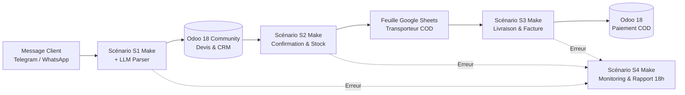

# COD-Flow : Automatisation ERP Odoo 18 pour le Cash On Delivery (Maroc)

[](https://www.odoo.com/)
[](https://www.docker.com/)
[](https://www.make.com/)
[](https://www.python.org/)
[](LICENSE)

---

## 📌 Présentation du Projet
Au Maroc, le commerce en ligne est dominé à plus de 85% par le mode de paiement **Cash On Delivery (COD)**. Les commandes sont majoritairement passées via les applications de messagerie (WhatsApp, Telegram, Instagram) avec des messages textuels ou vocaux en **Français** ou en **Darija marocaine translittérée (Arabizi)**.

La gestion manuelle de ce flux impose des contraintes sévères :
- **Perte de temps :** 3 à 5 minutes par commande pour déchiffrer, créer le client dans l'ERP, ajouter les articles et valider le devis.
- **Erreurs de saisie :** Coordonnées téléphoniques erronées ou adresses incomplètes bloquant la livraison.
- **Taux de retour élevé (20% à 30%) :** Absence de suivi réactif lorsque le livreur se heurte à un destinataire injoignable.
- **Doublons non détectés :** Clients passant deux fois la même commande par précaution, générant des expéditions inutiles.

**COD-Flow** automatise l'intégralité du cycle de vie de la commande :
```
Message Client (Telegram/WhatsApp) 
  ──► IA LLM (Français/Darija -> JSON) 
  ──► Make.com (Anti-doublon & Logique) 
  ──► Odoo 18 Community (Devis, Stock, Picking) 
  ──► Google Sheets (Transporteur) 
  ──► Facturation & Paiement Espèces COD
```

---

## 🏛️ Architecture Globale

Consultez la [documentation d'architecture détaillée](docs/architecture.md) pour les spécifications techniques complètes et les matrices de flux.



---

## 📁 Arborescence du Dépôt

```text
COD-Flow/
├── odoo/
│   ├── docker-compose.yml       # Déploiement Odoo 18 Community + PostgreSQL 16
│   ├── .env.example             # Modèle des variables de configuration
│   ├── .gitignore               # Protection des données locales et secrets
│   ├── odoo_client.py           # Client XML-RPC pur Python avec parseur .env
│   ├── test_odoo_api.py         # Test de connexion et vérification des modules
│   ├── create_custom_fields.py  # Création idempotente des champs x_* sur sale.order
│   ├── seed_products.py         # Création des produits démo (Odoo 18: consu + is_storable)
│   ├── seed_customers.py        # 5 clients de démo avec numéros normalisés (+212)
│   ├── seed_orderpoints.py      # Règles de stock minimum par produit
│   └── check_setup.py           # Rapport de conformité global (OK/KO)
├── make-scenarios/
│   ├── S1_prise_de_commande.md  # Spécification S1 : Extraction, anti-doublon, devis
│   ├── S2_confirmation_et_stock.md # Spécification S2 : Confirmation, stock, transporteur
│   ├── S3_livraison_et_encaissement.md # Spécification S3 : Suivi, facturation, relances
│   └── S4_monitoring_et_rapports.md    # Spécification S4 : Alertes & rapport quotidien 18h
├── llm/
│   ├── prompt_extraction.md     # Prompt système d'extraction (Français / Darija)
│   ├── schema.json              # Schéma JSON strict (Structured Outputs)
│   └── messages_test.json       # 22 messages de test variés et réalistes
├── tests/
│   └── send_test_messages.py    # Simulateur d'envoi vers le Webhook Make
├── docs/
│   ├── architecture.md          # Architecture complète et schéma Mermaid
│   ├── cahier_des_charges.md    # Spécifications fonctionnelles et techniques PFE
│   ├── mesure.md                # Méthodologie du protocole de mesure comparative
│   ├── mesure.csv               # Grille tabulaire pour les chronométrages réels
└── README.md                    # Documentation principale du projet
```

---

## 🛠️ Prérequis Système
- **Docker Desktop** ou moteur Docker avec Docker Compose.
- **Python 3.10+** (aucune bibliothèque tierce requise, utilisation exclusive de la bibliothèque standard).
- Compte gratuit **Make.com** (accès aux scénarios et webhooks).
- Compte **Telegram** pour la création du bot client et du canal superviseur (via `@BotFather`).
- Compte **Google** (Google Sheets pour la simulation de la feuille transporteur).
- Compte ngrok avec domaine fixe
---

## 🚀 Guide d'Installation Pas à Pas

### 1. Cloner le projet et préparer l'environnement
```bash
# Cloner le dépôt
git clone https://github.com/votre-nom/COD-Flow.git
cd COD-Flow

# Créer votre fichier d'environnement à partir du modèle
cp odoo/.env.example odoo/.env
# (Ou sous Windows PowerShell : Copy-Item odoo/.env.example odoo/.env)
```

Éditez le fichier `odoo/.env` avec vos valeurs (mots de passe de base de données, identifiants Odoo, tokens Make et Telegram).

---

### 2. Démarrer Odoo 18 avec Docker
```bash
cd odoo
docker compose up -d
```
Attendez environ 30 secondes que PostgreSQL et Odoo initialisent les conteneurs.
Accédez à l'interface Odoo via votre navigateur : **http://localhost:8069**

1. Créez une nouvelle base de données (ex: `codflow_db`) avec l'utilisateur administrateur (ex: `admin@codflow.ma`).
2. Dans le menu **Applications (Apps)** d'Odoo, installez les trois modules fondamentaux :
   - **Ventes** (`sale_management`)
   - **Inventaire** (`stock`)
   - **Facturation** (`account`)

---

### 3. Exécuter les scripts de configuration automatique
Les scripts Python sont conçus pour être **idempotents** : vous pouvez les exécuter plusieurs fois sans créer de doublons.

```bash
# Se placer dans le dossier odoo
cd odoo

# 1. Tester la communication XML-RPC avec Odoo
python test_odoo_api.py

# 2. Créer les champs personnalisés sur sale.order (x_canal, x_message_id, x_statut_livraison, x_motif_retour)
python create_custom_fields.py

# 3. Créer les articles du catalogue avec leurs stocks initiaux (Norme Odoo 18: type consu + is_storable)
python seed_products.py

# 4. Créer les 5 clients de démo avec coordonnées marocaines (+212)
python seed_customers.py

# 5. Configurer les règles de stock minimum (Orderpoints)
python seed_orderpoints.py

# 6. Vérifier l'ensemble de la configuration avec le rapport OK/KO
python check_setup.py
```

Le script `check_setup.py` doit afficher un résultat **100% [OK]**.

---

### 4. Configuration des Scénarios Make.com
Suivez pas à pas les fiches de spécification techniques rédigées dans `/make-scenarios` :
1. Implémentez [S1 - Prise de Commande](make-scenarios/S1_prise_de_commande.md) et associez son Webhook.
2. Implémentez [S2 - Confirmation et Stock](make-scenarios/S2_confirmation_et_stock.md).
3. Implémentez [S3 - Livraison et Encaissement](make-scenarios/S3_livraison_et_encaissement.md) relié à votre Google Sheet.
4. Activez [S4 - Monitoring et Rapport 18h](make-scenarios/S4_monitoring_et_rapports.md).

---

## 🧪 Simulation et Mesures Comparatives

Pour évaluer les performances de COD-Flow et mesurer le gain réel par rapport à la saisie manuelle :

1. Consultez le protocole d'expérimentation décrit dans [docs/mesure.md](docs/mesure.md).
2. Lancez le simulateur d'envoi de commandes :
   ```bash
   # Envoi des 20 commandes types vers le Webhook Make S1 avec un délai de 2 secondes
   python tests/send_test_messages.py --count 20 --delay 2.0
   ```
3. Reportez vos temps de chronométrage réels dans la grille [docs/mesure.csv](docs/mesure.csv).

---

## 📊 Résultats Expérimentaux (Données Réelles)

> **Note d'intégrité :** Les chiffres ci-dessous sont réservés aux mesures effectives que vous réaliserez sur votre banc de test. Aucun chiffre n'a été inventé.

| Indicateur de Performance | Saisie Manuelle dans Odoo | COD-Flow Automatisé | Gain / Écart |
| :--- | :--- | :--- | :--- |
| **Temps moyen par commande** | [À compléter] secondes | [À compléter] secondes | [À compléter] % |
| **Temps total pour 20 commandes** | [À compléter] minutes | [À compléter] minutes | [À compléter] % |
| **Erreurs de saisie (tel/adresse)** | [À compléter] / 20 | [À compléter] / 20 | [À compléter] % |
| **Interception des doublons** | [À compléter] | [À compléter] | N/A |
| **Création auto de la facture** | Manuelle | Instantanée (S3) | 100% automatisé |

---

## 🔧 Dépannage Fréquent

### 1. `ConnectionRefusedError` lors de l'exécution des scripts Python
- **Cause :** Le conteneur Docker Odoo n'est pas encore prêt ou écoute sur un port différent.
- **Solution :** Vérifiez l'état des conteneurs via `docker compose ps`. Assurez-vous que le port `8069` est accessible en ouvrant `http://localhost:8069` dans votre navigateur.

### 2. Échec d'authentification XML-RPC
- **Cause :** L'utilisateur ou le mot de passe dans `.env` ne correspond pas aux identifiants créés dans la base Odoo.
- **Solution :** Dans Odoo 18, allez dans les préférences de votre utilisateur administrateur > Onglet "Sécurité du compte" > Générez une **Clé d'API**, puis collez cette clé dans la variable `ODOO_PASSWORD` de votre fichier `.env`.

### 3. Rupture de stock inattendue lors de la confirmation (S2)
- **Cause :** Le produit `COD-SERUM-05` est volontairement configuré avec un stock bas (5 unités) et un seuil minimum de 10 unités pour déclencher et valider la branche de rupture et la création de la demande d'achat (`purchase.order`). C'est le comportement prévu !

---

## 📜 Licence et Auteur
Projet développé dans le cadre d'un Projet de Fin d'Études (PFE) en Ingénierie des Systèmes d'Information et Développement ERP (Odoo / SAP).
Distribué sous licence **MIT**.

