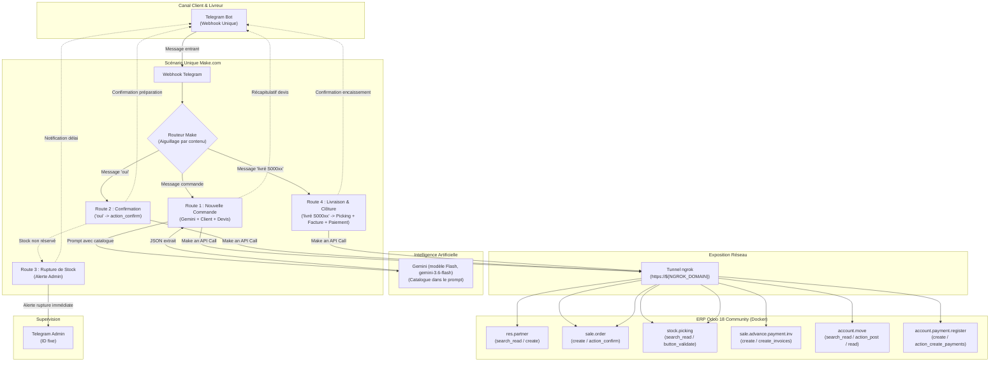

# Architecture Technique et Fonctionnelle - COD-Flow

## 1. Vision et Problématique Métier
Au Maroc, le commerce en ligne repose très largement sur le modèle **Cash On Delivery (COD)**, où les transactions s'initient sur les canaux conversationnels (notamment les applications de messagerie). 

Ce mode de fonctionnement génère plusieurs difficultés pour les commerçants :
1. **Saisie manuelle fastidieuse :** Recopier manuellement les messages non structurés (Français, Darija, fautes de frappe) dans un ERP prend un temps significatif par commande (durée à mesurer).
2. **Erreurs et doublons :** Risque de coquilles sur les numéros de téléphone, oublis d'articles ou commandes passées en double.
3. **Gestion des ruptures et de la livraison :** Nécessité d'identifier rapidement les ruptures de stock à la confirmation et de clôturer le cycle comptable (facture et paiement espèces) dès la livraison.

**COD-Flow** apporte une solution d'automatisation légère reliant un bot Telegram, l'API Google Gemini, un scénario Make.com unique à 4 routes, et **Odoo 18 Community** exposé par un tunnel ngrok.

---

## 2. Schéma Global d'Architecture (Mermaid)

---

## 3. Matrice des Composants et Technologies

| Composant | Technologie | Rôle & Responsabilité |
| :--- | :--- | :--- |
| **Hébergement ERP** | Docker & Docker Compose | Déploiement local Odoo 18.0 Community et PostgreSQL 16 Alpine |
| **Port Odoo** | Port configurable | Port exposé configurable (`${ODOO_PORT:-8269}` en local par défaut vers `8069`) |
| **Tunnel d'Exposition** | ngrok (service conteneurisé) | Expose l'instance Odoo locale sur un domaine fixe HTTPS pour les webhooks Make |
| **Orchestrateur** | Make.com (Scénario unique) | Scénario unique avec routeur aiguillant les messages vers les 4 routes métier |
| **Connecteur Odoo** | Module Make "Make an API Call" | Exécution d'appels natifs ORM (Modèle, Méthode, Paramètres) via le tunnel |
| **Moteur IA** | Gemini (modèle Flash, gemini-3.6-flash) | Extraction sémantique JSON (offre gratuite, catalogue inclus dans le prompt système) |
| **Canal Utilisateur** | Telegram Bot API | Interface conversationnelle unique (clients et notifications livreur) |
| **Supervision** | Telegram Bot API | Alertes de rupture de stock adressées à un identifiant administrateur fixe |

---

## 4. Modèle de Données et Méthodes Odoo 18 Utilisées

Tous les appels Odoo sont effectués via le module **"Make an API Call"** :
- **`res.partner` :**
  - `search_read` : recherche du client par numéro de téléphone.
  - `create` : création du contact client (nom, téléphone, adresse, ville).
- **`sale.order` :**
  - `create` : création du devis de vente à partir des articles identifiés par Gemini, avec stockage du `chat_id` Telegram dans le champ `client_order_ref`.
  - `search_read` : récupération du devis en cours sur confirmation `"oui"` via le champ `client_order_ref`.
  - `action_confirm` : validation du devis en bon de commande (déclenche la création du `stock.picking`).
- **`stock.picking` :**
  - `search_read` : inspection de l'état de réservation (`state`) et recherche du bon de livraison.
  - `button_validate` : validation de la livraison physique des marchandises.
- **`sale.advance.payment.inv` :**
  - `create` : instanciation du wizard de facturation avec méthode de facturation sur livraisons.
  - `create_invoices` : génération de la facture client `account.move` à l'état brouillon.
- **`account.move` :**
  - `search_read` : identification de la facture brouillon associée à la commande.
  - `action_post` : comptabilisation de la facture.
  - `read` : lecture du montant total et de l'état de la pièce comptable.
- **`account.payment.register` :**
  - `create` : instanciation du wizard d'enregistrement de paiement avec contexte de facture.
  - `action_create_payments` : validation de l'encaissement espèces COD et lettrage.

---

## 5. Limites de la v1
1. **Confirmation stricte :** La confirmation client n'est reconnue que sur le mot exact `"oui"`.
2. **Anti-doublon :** Fenêtre temporelle de détection fixée à 10 minutes par client.
3. **Catalogue dans le prompt :** Les références et tarifs des 5 produits de démo sont inscrits directement dans le prompt système Gemini.
4. **Référence de commande :** L'identifiant de chat Telegram est conservé dans le champ `client_order_ref` du devis `sale.order`.
5. **Administrateur fixe :** L'identifiant Telegram pour les alertes de rupture est unique et défini de manière statique.
6. **Infrastructure locale :** Le poste de travail, le moteur Docker et le conteneur ngrok doivent être en fonctionnement continu pour traiter les requêtes.
7. **Offre gratuite Gemini :** Utilisation du palier gratuit Gemini (les données transmises peuvent servir à l'entraînement des modèles de Google : données de test uniquement).
8. **Absence de fonctionnalités avancées :** Pas de feuille Google Sheets transporteur, pas de rapport quotidien programmé, pas de relances automatiques J+1/J+2 et pas de traitement des colis refusés.
9. **Conditions expérimentales :** Échantillon de test de 5 commandes, un seul opérateur, et temps manuel dépendant de la concentration.

---

## 6. Évolutions (v2)
- **Connecteurs e-commerce :** Intégration directe avec les boutiques WooCommerce et Shopify.
- **Rapports consolidés :** Génération et expédition d'un rapport quotidien récapitulant les ventes et encaissements à 18h.
- **Relances programmées :** Suivi automatisé des clients injoignables à J+1 et J+2.
- **Demande d'achat :** Création automatique d'une demande de réassort (`purchase.order`) auprès des fournisseurs en cas de rupture.
- **Canal WhatsApp :** Support de WhatsApp Business API via Twilio ou Meta Cloud API.
