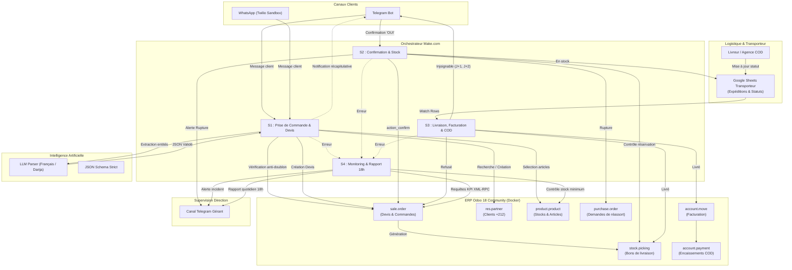

# Architecture Technique et Fonctionnelle - COD-Flow

## 1. Vision et Problématique Métier
Au Maroc, le commerce en ligne repose à plus de 85% sur le modèle **Cash On Delivery (COD)**, où les transactions s'initient sur les canaux conversationnels (WhatsApp, Telegram, Instagram). 
Ce mode de fonctionnement génère trois goulots d'étranglement critiques pour les e-commerçants :
1. **Saisie manuelle fastidieuse :** Recopier manuellement les messages non structurés (Français, Darija, fautes) dans un ERP prend 3 à 5 minutes par commande.
2. **Erreurs et doublons :** Mauvais numéros de téléphone, oublis d'articles, commandes passées en double créant des surcoûts d'expédition.
3. **Taux d'échec de livraison élevé (20% à 30%) :** Absence de relances automatisées des clients injoignables et retards de synchronisation avec le transporteur.

**COD-Flow** résout l'ensemble de cette chaîne en créant une passerelle automatisée de bout en bout entre la messagerie instantanée, un LLM spécialisé, Make.com, et **Odoo 18 Community**.

---

## 2. Schéma Global d'Architecture (Mermaid)

---

## 3. Matrice des Composants et Technologies

| Composant | Technologie / Version | Rôle & Responsabilité |
| :--- | :--- | :--- |
| **Hébergement ERP** | Docker & Docker Compose | Conteneurisation Odoo 18.0 Community et PostgreSQL 16 Alpine |
| **Moteur ERP** | Odoo 18 Community Edition | Gestion des ventes, CRM, gestion de stock par emplacement, facturation et paiements |
| **API Gateway ERP** | XML-RPC standard (`/xmlrpc/2/object`) | Interface sans dépendances externes pour l'automatisation Make et scripts Python |
| **Orchestrateur** | Make.com (Scénarios S1 à S4) | Routage des webhooks, orchestration des flux métier, logique décisionnelle |
| **Moteur LLM** | GPT-4o-mini / Gemini Flash | Extraction sémantique bilingue (Français, Darija, Arabizi) vers JSON strict |
| **Simulateur Logistique** | Google Sheets API | Registre partagé avec le transporteur COD (livré, injoignable, refusé) |
| **Canaux Utilisateurs** | Telegram Bot API / Twilio WhatsApp | Messagerie bidirectionnelle avec les clients finaux |
| **Canal Superviseur** | Telegram Bot API | Alertes d'erreurs en temps réel et diffusion du rapport d'activité quotidien à 18h |

---

## 4. Modèle de Données et Personnalisations Odoo 18

### 4.1 Extensions sur le modèle `sale.order`
Les champs personnalisés suivants sont injectés via `ir.model.fields` :
- `x_canal` (`selection`) : `[('whatsapp', 'WhatsApp'), ('telegram', 'Telegram'), ('instagram', 'Instagram')]`
- `x_message_id` (`char`, `index=True`) : Identifiant unique du message conversationnel, pivot du mécanisme anti-doublon.
- `x_statut_livraison` (`selection`) : `[('en_attente', 'En attente'), ('expedie', 'Expédié'), ('livre', 'Livré'), ('refuse', 'Refusé'), ('injoignable', 'Injoignable')]`
- `x_motif_retour` (`char`) : Raison déclarée du retour (ex: "Client indisponible après 3 relances", "Refus à la porte").

### 4.2 Spécificité Odoo 18 sur `product.template`
Dans Odoo 18, la gestion des produits stockables a évolué :
- Le champ `type` prend la valeur `'consu'` (Consommable / Marchandise).
- Le suivi des stocks est activé via le booléen `'is_storable' = True`.
- Les niveaux de stock physique sont gérés au niveau des variantes `product.product` via `stock.quant`.

---

## 5. Règles de Résilience et Idempotence

1. **Anti-doublon à double verrou :**
   - *Verrou technique :* Unicité du `x_message_id` issu de la messagerie instantanée.
   - *Verrou métier :* Détection des commandes issues du même numéro de téléphone portant sur les mêmes articles enregistrées il y a moins de 24h.
2. **Normalisation téléphonique automatique :**
   - Tout numéro marocain saisi sous format local (`06...`, `07...`, `05...`), international (`212...`, `+212...`) ou avec séparateurs d'espaces est normalisé au format E.164 `+212XXXXXXXXX`.
3. **Idempotence des transactions financières :**
   - La création de facture (`_create_invoices`) et le paiement COD ne peuvent être exécutés qu'une seule fois grâce au contrôle préalable du champ `x_statut_livraison != 'livre'`.

